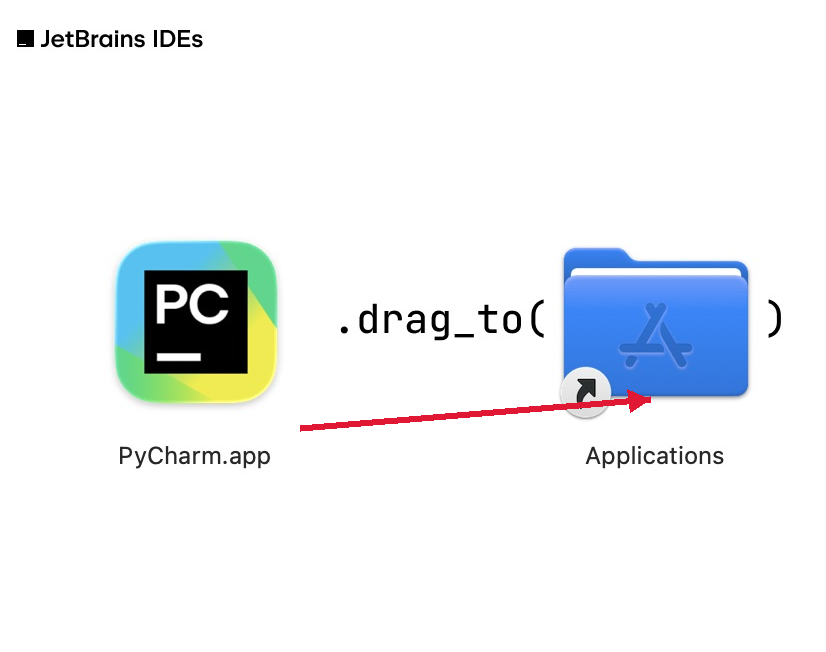
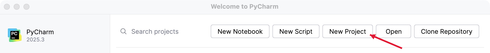
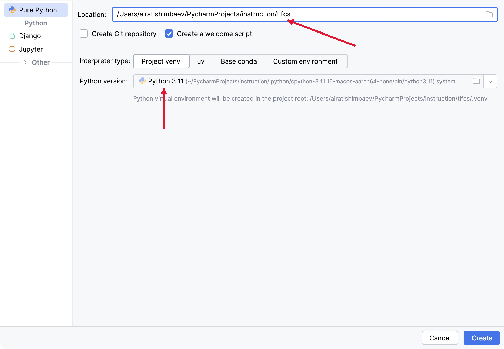
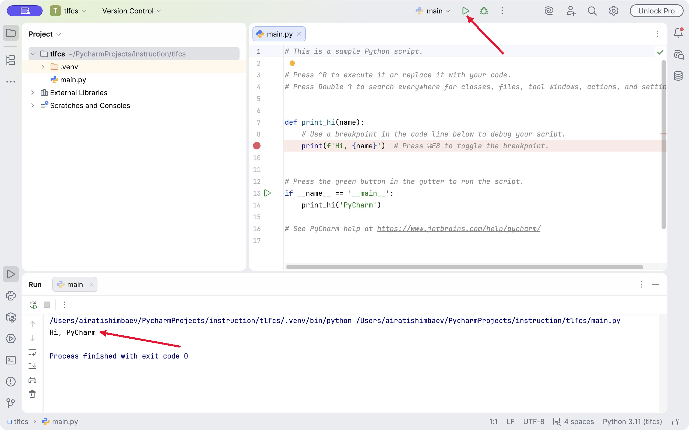
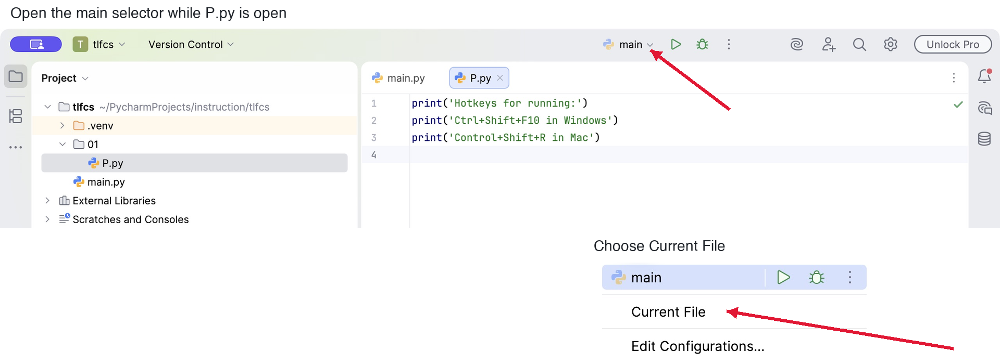
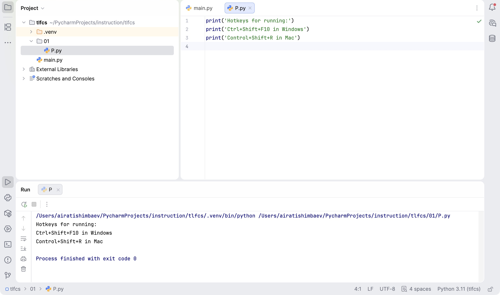

Инструкции: [Java и IntelliJ IDEA](/software/java/) · [C++ и CLion](/software/cpp/) · **Python и PyCharm**.

Для занятий нужны две программы. **Python** выполняет ваш код. **PyCharm** помогает писать, запускать и проверять программы.

Выберите свой компьютер: [Windows](#windows) · [Mac](#mac). После установки переходите к [созданию проекта](#project).

В этой инструкции для первой домашней установки выбран **Python 3.14.10**, из той же ветки 3.14, что и в LMS. Перед соревнованием сверяйте версию с памяткой своей площадки. Если преподаватель уже назначил другую версию Python, используйте её.

О подготовке к соревнованиям: [какие программы предусмотрены требованиями ВсОШ и что известно о площадках Татарстана](/software/olympiads/).

## Скачивание из России

В инструкции используем **PyCharm 2025.3**, как в LMS LearnCS. Основные ссылки ведут на стороннее зеркало **mirror.ismdeep.com** и позволяют скачать установщик напрямую, без перехода на страницу загрузок JetBrains.

| Компьютер | Скачать PyCharm 2025.3 |
| --- | --- |
| Windows, Intel или AMD (x64) | [Установщик .exe](https://mirror.ismdeep.com/jetbrains/PyCharm/release/2025.3/2025.3/windows/pycharm-2025.3.exe) |
| Mac, Intel | [Установщик .dmg](https://mirror.ismdeep.com/jetbrains/PyCharm/release/2025.3/2025.3/mac/pycharm-2025.3.dmg) |
| Mac, Apple Silicon (чипы M1, M2 и новее) | [Установщик .dmg](https://mirror.ismdeep.com/jetbrains/PyCharm/release/2025.3/2025.3/macM1/pycharm-2025.3-aarch64.dmg) |

На Mac тип процессора указан в **меню Apple → Об этом Mac**. В Windows откройте **Параметры → Система → О системе → Тип системы**. Приведённый Windows-файл рассчитан на x64; для Windows на ARM нужен отдельный установщик.

В PyCharm 2025.3 базовые возможности Python бесплатны и остаются доступными после пробного периода Pro. Для выполнения этой инструкции подписка не требуется. [Пояснение JetBrains](https://www.jetbrains.com/help/pycharm/unified-pycharm.html).

### Собственные загрузки LearnCS

**Загрузки LearnCS:** открытая сборка **PyCharm Community Edition 2025.3** из [официального выпуска JetBrains](https://github.com/JetBrains/intellij-community/releases/tag/pycharm/2025.3). Мы размещаем неизменённые установщики в GitHub Releases проекта LearnCS. Это отдельная сборка открытых компонентов; пробного Pro в ней нет. Это дополнительный вариант, если основная ссылка выше не открывается.

| Компьютер | Скачать из загрузок LearnCS | Технические сведения |
| --- | --- | --- |
| Windows | [Установщик .exe](https://github.com/ufarobot/learncs/releases/download/software-pycharm-community-2025.3/pycharm-2025.3.exe) | Windows x64; 474 765 896 байт, около 475 МБ |
| Mac | [Установщик .dmg](https://github.com/ufarobot/learncs/releases/download/software-pycharm-community-2025.3/pycharm-2025.3-aarch64.dmg) | Apple Silicon, ARM64; 599 519 091 байт, около 600 МБ |

Исходный выпуск JetBrains опубликован 8 декабря 2025 года. Для Mac с процессором Intel или Windows на ARM нужны другие установщики; приведённые два файла для них не выбирайте.

Код Community распространяется по [Apache 2.0](https://github.com/JetBrains/intellij-community/blob/pycharm/2025.3/LICENSE.txt), комплектный JetBrains Runtime — по [GPLv2 с Classpath Exception](https://github.com/JetBrains/JetBrainsRuntime/blob/jbr-release-21.0.8b1163.69/LICENSE). Лицензии и уведомления включены в установщики. Рядом с ними доступны [исходники Runtime](https://github.com/ufarobot/learncs/releases/download/software-pycharm-community-2025.3/JetBrainsRuntime-21.0.8b1163.69-source.tar.gz), [исходники библиотек](https://github.com/ufarobot/learncs/releases/download/software-pycharm-community-2025.3/third-party-sources.zip) и [пояснение к их лицензиям и версиям](https://github.com/ufarobot/learncs/releases/download/software-pycharm-community-2025.3/SOURCE-NOTICE.md). [Исходники Community](https://github.com/JetBrains/intellij-community/tree/pycharm/2025.3) · [Сведения о файлах и SHA-256](https://github.com/ufarobot/learncs/releases/tag/software-pycharm-community-2025.3).

<h2 id="windows">Windows</h2>

1. Скачайте [Python 3.14.10 для Windows x64](https://www.python.org/ftp/python/3.14.10/python-3.14.10-amd64.exe). На [странице выпуска](https://www.python.org/downloads/release/python-31410/) этот файл называется **Windows installer (64-bit)**. Это обычный установщик; пакет с названием *embeddable* для этой инструкции не нужен.
2. Откройте скачанный `.exe`. Отметьте **Add Python to PATH**, затем нажмите **Install Now**. Дождитесь сообщения об успешной установке.
3. Откройте новое окно командной строки и выполните:

   ```text
   py -3.14 --version
   ```

   Ожидаемый ответ: `Python 3.14.10`.
4. Скачайте выбранный выше установщик PyCharm для Windows, откройте `.exe` и пройдите шаги мастера. Затем запустите PyCharm из меню «Пуск».
5. Перейдите к [созданию проекта](#project).

Порядок установки Python описан в [официальном руководстве для Windows](https://docs.python.org/3.14/using/windows.html#the-full-installer). Если компьютер школьный и установка запрещена, её должен выполнить администратор.

<h2 id="mac">Mac</h2>

1. Скачайте [Python 3.14.10 для macOS](https://www.python.org/ftp/python/3.14.10/python-3.14.10-macos11.pkg). Этот установщик Python подходит и для Apple Silicon, и для Intel.
2. Откройте скачанный `.pkg` и пройдите шаги установки. Затем в папке **Программы → Python 3.14** запустите **Install Certificates.command** и дождитесь завершения.
3. Откройте «Терминал» и выполните:

   ```text
   python3.14 --version
   ```

   Ожидаемый ответ: `Python 3.14.10`.
4. Скачайте выбранный выше PyCharm для Mac. Для компьютеров с чипом M1, M2, M3 и следующих поколений выбирайте **Apple Silicon**. Откройте `.dmg` и перетащите **PyCharm.app** или **PyCharm CE.app** в **Applications**.
5. Запустите PyCharm из папки «Программы» и переходите к [созданию проекта](#project).

<figure>
<a href="/assets/software/01-install-mac.png"></a>
<figcaption>Установка PyCharm на Mac: перетащите приложение в Applications</figcaption>
</figure>

Порядок установки Python описан в [официальном руководстве для macOS](https://docs.python.org/3.14/using/mac.html). Системный Python, который уже может быть на Mac, удалять или заменять не нужно.

<h2 id="project">Создайте проект</h2>

Проект объединяет ваши программы и их настройки в одной папке. При первом запуске PyCharm прочитайте условия использования. Для совпадения названий кнопок с инструкцией выберите английский интерфейс.

Снимки ниже сделаны в **PyCharm 2025.3 на Mac**. На них выбран **Python 3.11**; в новом проекте по этой инструкции выберите установленный **Python 3.14**. В более новой версии PyCharm расположение отдельных элементов может отличаться.

1. Нажмите **New Project**.

   <figure>
<a href="/assets/software/02-new-project.png"></a>
<figcaption>Кнопка New Project на стартовом экране PyCharm 2025.3</figcaption>
</figure>

2. Выберите **Pure Python**. В конце поля **Location** задайте имя папки проекта, например `tlfcs`.
3. Выберите **Project venv**. PyCharm создаст отдельное окружение Python для этого проекта.
4. В поле **Python version** выберите **Python 3.14**. Если его нет в списке, нажмите значок папки и укажите установленный интерпретатор. Его расположение можно узнать командой `py -3.14 -c "import sys; print(sys.executable)"` в Windows или `python3.14 -c "import sys; print(sys.executable)"` на Mac. Не копируйте чужой путь со снимка.
5. Оставьте **Create a welcome script** включённым, а **Create Git repository** выключенным. Нажмите **Create** и дождитесь открытия проекта.

<figure>
<a href="/assets/software/03-project-settings.png"></a>
<figcaption>Настройка проекта: Location, Project venv, Python version и кнопка Create</figcaption>
</figure>

На снимке показано расположение поля Python version. Номер 3.11 в примере отличается от установленного по этой инструкции Python 3.14.

[Официальная инструкция создания проекта](https://www.jetbrains.com/help/pycharm/2025.3/creating-empty-project.html).

## Запустите первую программу

Откройте `main.py` в левой панели **Project** и нажмите зелёную кнопку **Run**. Для стандартного приветственного примера внизу появятся `Hi, PyCharm` и `Process finished with exit code 0`. Последняя строка означает, что программа завершилась без ошибки.

<figure>
<a href="/assets/software/04-main-run.png"></a>
<figcaption>Приветственный main.py и результат его запуска в окне Run</figcaption>
</figure>

Если `main.py` не создан, нажмите правой кнопкой на папку проекта, выберите **New → Python File**, введите `main` и напишите:

```python
print('Hi, PyCharm')
```

Нажмите правой кнопкой внутри файла и выберите **Run 'main'**.

## Создайте свой файл

1. В панели **Project** нажмите правой кнопкой на папку проекта `tlfcs`. Выберите **New → Directory**, введите `01` и нажмите Enter.
2. Нажмите правой кнопкой на новую папку `01`. Выберите **New → Python File** и введите `P`. PyCharm создаст файл `P.py`.
3. Впишите три строки:

   ```python
   print('Hotkeys for running:')
   print('Ctrl+Shift+F10 in Windows')
   print('Control+Shift+R in Mac')
   ```

4. Оставьте `P.py` открытым. Рядом с зелёной кнопкой запуска смените **main** на **Current File**. Теперь кнопка запускает открытый файл.

   <figure>
<a href="/assets/software/07-current-file.png"></a>
<figcaption>Выбор Current File рядом с кнопкой запуска</figcaption>
</figure>

5. Нажмите **Run**. Внизу должны появиться все три строки и `Process finished with exit code 0`.

   <figure>
<a href="/assets/software/08-p-result.png"></a>
<figcaption>Файл P.py успешно запущен: видны код, три строки вывода и exit code 0</figcaption>
</figure>

Для проверки создайте в той же папке файл `J.py`, напишите `print('Запущен J.py')` и запустите его. В окне **Run** должна появиться строка `Запущен J.py`. Если вы снова видите три строки из предыдущего примера, запускается `P.py`. Теперь вы можете проверить, что запускаете именно тот файл, который редактируете.

Если запускается прежняя программа, проверьте **Current File** или нажмите правой кнопкой в нужном файле и выберите **Run** с его именем. Если PyCharm пишет, что интерпретатор не настроен, вернитесь к выбору установленного Python. [Способы запуска в документации JetBrains](https://www.jetbrains.com/help/pycharm/2025.3/running-applications.html).
